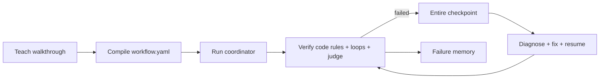

# ShowOnce

## Current verified demo

Start `python -m showonce.server` and visit http://127.0.0.1:8765.
The control room executes a temporary sample repository, reproduces a bug,
verifies a deliberately wrong first patch, restores its saved source/context,
and verifies a deterministic second patch with three independent assertions.
Displayed output comes from actual subprocess executions. It is an offline
fixture, with no model calls, external messages, or hosted Neatlogs lookup.
The checkpoint in this path is local state, not an Entire checkpoint.

`python evals/run_recovery.py` executes 10 variants of this same bug family
with recovery disabled and enabled, recording test exit-code outcomes and
elapsed time in unique JSON/CSV files. These results measure the deterministic
fixture only, not LLM performance or diverse real-world recovery.

Earlier reported payout 50/50 scores and recovery scores were hardcoded and
are invalid performance evidence. The payout benchmark is now disabled.
The older `ui/index.html` is a scripted visual prototype; the served control
room uses `ui/control.html`. Neither currently integrates the AG-UI SDK.
Earlier sponsor descriptions below describe intended integrations; live
trace-driven model repair, authenticated Entire restore, enforceable external
approvals, and a completed cfo.ai business model remain unfinished.

Show your agent the job once. It compiles a walkthrough into a workflow contract, runs it with traced steps, verifies each contract, and recovers from failures with checkpointed context. The flagship demo is evidence-bound payout routing: code decides whether a route is deliverable, while the agent explains only what the evidence supports.

## The demo wow moment

The implement worker receives a bug report, creates a Linear issue, changes the sample repo, and hits an injected failing test. It then calls the Neatlogs MCP: `search_traces` finds the failed run and `get_trace_context` reads the span tree. ShowOnce uses that evidence to retry from an Entire checkpoint, reruns the test, and produces a draft Slack/Linear update for human approval.

Set `NEATLOGS_PROJECT_KEY` to use live Neatlogs MCP. With no key, the same sequence runs with clearly labelled MOCK trace context; no fake production result is reported.

### Live integrations

Copy `.env.example` to `.env` and set `NEATLOGS_PROJECT_KEY`, `SLACK_BOT_TOKEN`, and `LINEAR_API_KEY`. ShowOnce then queries Neatlogs MCP, posts to Slack, and creates Linear issues. Leave any key blank to use the labelled MOCK adapter. External updates should be run as drafts during the demo; use a human approval step before sending production messages.

### Slack → Linear → fix → Slack/Teams pipeline

```powershell
python cli.py watch            # poll Slack every 15s; --once for a single pass
python cli.py handle "bug: add(2,3) returns -1"   # run one report without reading Slack
python cli.py inject-bug       # put the sample bug back to demo again
python cli.py payout ID wise 4900   # deterministic refusal with source evidence
python evals/payout_eval.py        # 50 synthetic baseline vs ShowOnce payout cases
```

For each new top-level Slack message containing `SLACK_TRIGGER` (default `bug`), ShowOnce creates a Linear issue, acknowledges in the Slack thread, fixes `sample_repo`, runs its real test, then closes the Linear issue (moves it to the team's Done state with a comment) and replies "Code has been fixed" in the thread. It also posts to Teams if `TEAMS_WEBHOOK_URL` is set. If the test still fails, the issue stays open with the test output attached. `watch` starts from "now", so older channel history is not processed; its position is kept in `evidence/slack_watch_state.json`.

## Architecture



## Run

```powershell
python -m pip install -r requirements.txt
python cli.py demo
python evals/run_recovery.py
```

Open `ui/index.html` in a browser for the controlled AG-UI-style Control Room demo. It streams the recovery story visually: failed test → Neatlogs trace inspection → Entire checkpoint → human approval → passing retry. The static UI is dependency-free; its event names and flow are ready to be replaced with a live AG-UI transport when the backend is deployed.

Mock Slack and Linear adapters are labelled `MOCK` in code. The sample repo fix and test are real. Set `OPENAI_API_KEY` only when connecting an LLM compiler/judge; secrets are gitignored.

## Sponsor tools

- neatlogs: `showonce.observability.init_tracing()` initializes tracing and each coordinator step is a span. See `evidence/neatlogs_dev_log.md` for two found → fixed → verified entries.
- Entire: installed with CLI 0.11.4, enabled for Codex in `.entire/settings.json`, and used for repository checkpoints. The implement worker is configured by `entire enable --agent codex` in its own checkout. `evidence/entire/` stores retry context snapshots. The runtime fallback is local checkpoint JSON because the worker cannot assume an authenticated Entire API.
- cfo.ai: `evidence/business_plan.md` is the requested placeholder.
- AG-UI / CopilotKit: the control room uses the AG-UI event-driven model and controlled generative UI cards for timeline, trace evidence, checkpoint state, diffs, tests, and approvals. AG-UI is complementary to MCP: MCP supplies tools, AG-UI supplies the user-facing event stream.

### Retry and restored context

Example checkpoint: `evidence/entire/retry-fix-1.json` records the failed step, failure, lessons, and the decision to restore that context before retrying. The retry then re-runs verification from the restored step rather than restarting the workflow.

## Measured results and limitations

Run `python evals/run_recovery.py` or `python evals/payout_eval.py`; they write JSON and CSV results. The payout cases are synthetic fixtures generated from the local demo rule sheet, not real financial records, tax advice, or evidence of actual provider eligibility. The benchmark is deterministic and offline; its baseline is a comparison scaffold until a real model is connected. Any unreachable model call must be marked `INVALID` and excluded. This prototype does not claim to solve recovery; it measures the recovery behavior available in each run.
