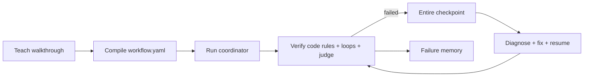

# ShowOnce

Show your agent the job once. It compiles a walkthrough into a workflow contract, runs it with traced steps, verifies each contract, and recovers from failures with checkpointed context.

## Architecture



## Run

```powershell
python -m pip install -r requirements.txt
python cli.py demo
python evals/run_recovery.py
```

Mock Slack and Linear adapters are labelled `MOCK` in code. The sample repo fix and test are real. Set `OPENAI_API_KEY` only when connecting an LLM compiler/judge; secrets are gitignored.

## Sponsor tools

- neatlogs: `showonce.observability.init_tracing()` initializes tracing and each coordinator step is a span. See `evidence/neatlogs_dev_log.md` for two found → fixed → verified entries.
- Entire: installed with CLI 0.11.4, enabled for Codex in `.entire/settings.json`, and used for repository checkpoints. The implement worker is configured by `entire enable --agent codex` in its own checkout. `evidence/entire/` stores retry context snapshots. The runtime fallback is local checkpoint JSON because the worker cannot assume an authenticated Entire API.
- cfo.ai: `evidence/business_plan.md` is the requested placeholder.

### Retry and restored context

Example checkpoint: `evidence/entire/retry-fix-1.json` records the failed step, failure, lessons, and the decision to restore that context before retrying. The retry then re-runs verification from the restored step rather than restarting the workflow.

## Measured results and limitations

Run `python evals/run_recovery.py`; it writes timestamped JSON and CSV without overwriting prior runs. The bundled harness is deterministic and offline, so its token/cost fields are zero and are not evidence of LLM performance. Any unreachable model call must be marked `INVALID` and excluded. This prototype does not claim to solve recovery; it measures the recovery behavior available in each run.

